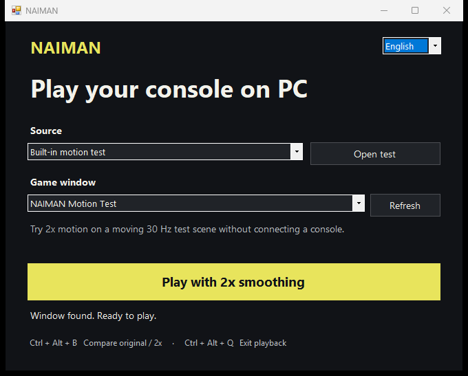

[Polski](./pl.html)

## Play your console on PC with smoother motion

Open your Xbox stream, select its window and press **Play with 2x smoothing**. NAIMAN estimates motion between frames on your PC and draws an intermediate image. Your streaming app still handles the controller and sound.

**[Download NAIMAN for Windows x64](https://github.com/promptowy/naiman/releases/download/v0.1.0-preview.1/NAIMAN.exe)** · [Release notes and checksum](https://github.com/promptowy/naiman/releases/tag/v0.1.0-preview.1)

Portable preview for Windows 11 x64, an SDR display and a GPU with Direct3D 11 feature level 11.0. English and Polish. The executable includes the capture engine. Launch it as a normal user.

## Connect your game

1. **Xbox.** Choose Xbox Remote Play and click **Open Xbox**. Start streaming from your console and keep the game tab active. Return to NAIMAN. When it finds the window, click **Play with 2x smoothing**.
2. **PlayStation.** Start a stream in PS Remote Play or chiaki-ng. Choose that source in NAIMAN. This path awaits a physical PS5 test.
3. **HDMI capture card.** Open a windowed projector for your card in OBS, then select it in NAIMAN. Enable audio monitoring in OBS if you want to hear the card through your PC. This path awaits a physical card test.

If your browser uses another window title, choose **Choose another window**. Restore the source if Windows has minimized it. Move the source to the display where you want to play. The session follows that monitor.

**Ctrl + Alt + B** switches between original and interpolated playback. **Ctrl + Alt + Q** returns to the launcher. To try it before connecting a console, select **Built-in motion test**, click **Open test**, then start playback.

[Read the measurements and limitations](./testing.html) · [Browse the source](https://github.com/promptowy/naiman)
