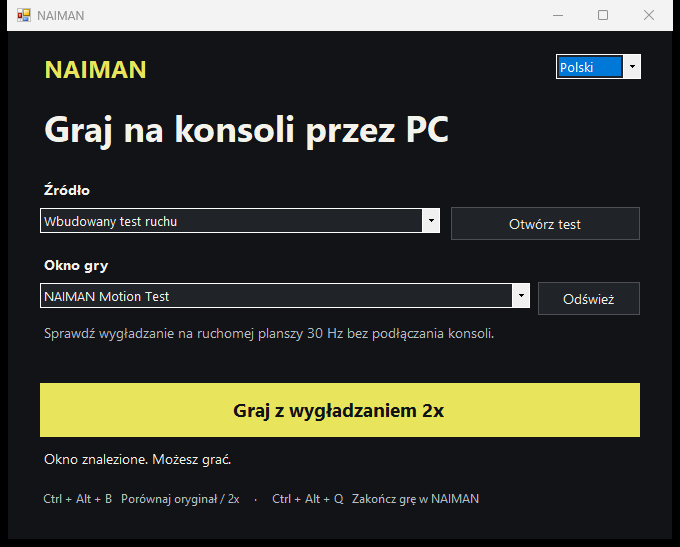

[English](./)

## Graj na konsoli przez PC z płynniejszym obrazem

Otwórz transmisję z Xboxa, wybierz jej okno i kliknij **Graj z wygładzaniem 2x**. NAIMAN szacuje ruch między klatkami i na twoim GPU rysuje klatkę pośrednią. Pad i dźwięk obsługuje aplikacja, w której grasz.

**[Pobierz NAIMAN na Windows x64](https://github.com/promptowy/naiman/releases/download/v0.1.0-preview.1/NAIMAN.exe)** · [Wydanie i suma kontrolna](https://github.com/promptowy/naiman/releases/tag/v0.1.0-preview.1)

Wersja testowa dla Windows 11 x64, ekranu SDR i GPU obsługującego Direct3D 11 na poziomie funkcji 11.0. Silnik jest w pliku EXE. Uruchamiasz go na zwykłym koncie użytkownika, po polsku lub angielsku.

## Jak zacząć

1. **Xbox.** Wybierz Xbox Remote Play i kliknij **Otwórz Xbox**. Połącz się z konsolą i zostaw aktywną kartę z grą. Wróć do NAIMAN. Gdy pojawi się okno, kliknij **Graj z wygładzaniem 2x**.
2. **PlayStation.** Uruchom transmisję w PS Remote Play albo chiaki-ng i wybierz to źródło. Ten tryb czeka na test z fizycznym PS5.
3. **Karta HDMI.** Otwórz projektor okienkowy źródła karty w OBS i wybierz go w NAIMAN. Jeśli chcesz słyszeć dźwięk z karty przez PC, włącz odsłuch w OBS. Ten tryb czeka na test z fizyczną kartą.

Jeśli przeglądarka inaczej nazwała kartę, kliknij **Wybierz inne okno**. Przywróć okno gry, jeśli zostało zminimalizowane. Przenieś je na monitor, na którym chcesz grać.

**Ctrl + Alt + B** przełącza oryginał i wygładzanie. **Ctrl + Alt + Q** wraca do okna NAIMAN. Żeby sprawdzić efekt bez konsoli, wybierz **Wbudowany test ruchu**, kliknij **Otwórz test**, a potem włącz wygładzanie.

[Zobacz pomiary i ograniczenia](./testing.html) · [Kod na GitHubie](https://github.com/promptowy/naiman)
